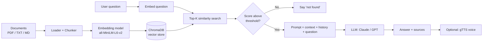

# 📚 RAG Chatbot

A Retrieval-Augmented Generation (RAG) chatbot that answers questions about **your own documents** (PDF, TXT, Markdown). It retrieves the most relevant passages with semantic search, then asks an LLM to answer using only that context, and shows the sources it used. It includes a REST API, a web UI, a command-line interface, and optional voice answers.


> Add a screenshot or demo GIF of the Streamlit UI here, e.g. ``.

---

## Table of Contents
- [Features](#features)
- [How it works](#how-it-works)
- [Tech stack](#tech-stack)
- [Project structure](#project-structure)
- [Getting started](#getting-started)
- [Configuration](#configuration)
- [Usage](#usage)
- [API reference](#api-reference)
- [Design decisions](#design-decisions)
- [Testing](#testing)
- [Docker](#docker)
- [Troubleshooting](#troubleshooting)
- [Limitations](#limitations)
- [Roadmap](#roadmap)
- [Contributing](#contributing)
- [License](#license)
- [Author](#author)

---

## Features

- **Multi-format ingestion:** PDF (page-aware), TXT and Markdown files.
- **Semantic search:** local embeddings with `sentence-transformers` and a persistent ChromaDB vector store, so no embedding API key or cost.
- **Grounded answers with citations:** the LLM is instructed to answer only from retrieved context and to cite the source file and page.
- **"Not found" handling:** if nothing relevant is retrieved, the bot says so instead of guessing, and skips the LLM call.
- **Conversation memory:** recent chat turns are passed along so follow-up questions work.
- **Two LLM providers:** Anthropic (Claude) or OpenAI, switched with one environment variable.
- **Voice answers:** optional text-to-speech (gTTS) that returns an mp3.
- **Three interfaces:** FastAPI REST API (with auto-generated docs), Streamlit chat UI, and a terminal CLI.
- **Idempotent indexing:** re-indexing the same file never creates duplicates.
- **Document management:** upload, list and delete documents through the UI or API.
- **Tested and containerised:** pytest tests and a Dockerfile are included.

## How it works



**Indexing:** each document is split into overlapping chunks (default 800 characters with 150 overlap). Each chunk is embedded and stored with metadata (file name, page, chunk number). Chunk IDs are content hashes, so re-indexing is safe.

**Answering:** the question is embedded and the `TOP_K` most similar chunks are retrieved by cosine similarity. Chunks scoring below `MIN_SCORE` are discarded. If anything remains, the chunks, recent chat history and the question are sent to the LLM with a system prompt that forbids answering outside the context. The answer is returned together with its sources.

## Tech stack

| Layer | Technology |
|---|---|
| Language | Python 3.10+ |
| API | FastAPI, Uvicorn, Pydantic |
| Embeddings | sentence-transformers (`all-MiniLM-L6-v2`) |
| Vector database | ChromaDB (persistent, cosine similarity) |
| PDF parsing | pypdf |
| LLMs | Anthropic API or OpenAI API |
| Voice | gTTS |
| UI | Streamlit |
| Testing | pytest, httpx |
| Packaging | Docker |

## Project structure

```
rag-chatbot/
├── app/
│   ├── __init__.py
│   ├── config.py        # Settings loaded from environment variables
│   ├── loader.py        # File loading and text chunking
│   ├── vectorstore.py   # Embeddings + ChromaDB (add, search, delete)
│   ├── llm.py           # Prompting and LLM provider calls
│   ├── rag.py           # Pipeline: ingest -> retrieve -> generate
│   ├── tts.py           # Text-to-speech
│   └── api.py           # FastAPI endpoints
├── data/
│   └── docs/            # Put your documents here (sample.md included)
├── tests/
│   ├── test_chunking.py
│   └── test_api.py
├── cli.py               # Command-line interface
├── streamlit_app.py     # Web UI
├── requirements.txt
├── .env.example
├── Dockerfile
├── LICENSE
└── README.md
```

## Getting started

### Prerequisites
- Python 3.10 or newer
- An API key from [Anthropic](https://console.anthropic.com/) **or** [OpenAI](https://platform.openai.com/)
- Internet access on first run (to download the embedding model, about 90 MB) and for voice answers

### Installation

```bash
# 1. Clone the repository
git clone https://github.com/Rohitchoubey931/rag-chatbot.git
cd rag-chatbot

# 2. Create and activate a virtual environment
python3 -m venv .venv
source .venv/bin/activate          # macOS / Linux
# .venv\Scripts\activate           # Windows

# 3. Install dependencies
pip install -r requirements.txt

# 4. Configure your API key
cp .env.example .env
# Open .env and paste your key
```

### Index the sample document and chat

```bash
python cli.py ingest
python cli.py chat
```

Try asking: *"Why does RAG reduce hallucinations?"*

## Configuration

All settings are read from environment variables (or the `.env` file).

| Variable | Default | Description |
|---|---|---|
| `LLM_PROVIDER` | `anthropic` | `anthropic` or `openai` |
| `ANTHROPIC_API_KEY` | none | Required if using Anthropic |
| `OPENAI_API_KEY` | none | Required if using OpenAI |
| `LLM_MODEL` | provider default | Override the model name |
| `EMBEDDING_MODEL` | `sentence-transformers/all-MiniLM-L6-v2` | Any sentence-transformers model |
| `CHUNK_SIZE` | `800` | Characters per chunk |
| `CHUNK_OVERLAP` | `150` | Characters shared between neighbouring chunks |
| `TOP_K` | `4` | Chunks sent to the LLM |
| `MIN_SCORE` | `0.2` | Minimum cosine similarity to count as relevant |
| `MAX_TOKENS` | `1000` | Maximum answer length |
| `HISTORY_TURNS` | `6` | Previous messages included for follow-ups |
| `DOCS_DIR`, `CHROMA_DIR`, `AUDIO_DIR` | under `data/` | Storage locations |

## Usage

### 1. Web UI (Streamlit)

```bash
streamlit run streamlit_app.py
```

Upload files in the sidebar, click **Index uploaded files**, then ask questions. Expand a source to see the exact passage used. Switch on **Voice answers** to hear the response.

### 2. REST API (FastAPI)

```bash
uvicorn app.api:app --reload
```

Interactive docs are available at <http://127.0.0.1:8000/docs>.

### 3. Command line

```bash
python cli.py ingest           # index everything in data/docs
python cli.py chat             # chat in the terminal
python cli.py chat --voice     # also save answers as mp3 files
```

## API reference

| Method | Endpoint | Description |
|---|---|---|
| GET | `/health` | Service status |
| POST | `/ingest` | Index every file in `data/docs` |
| POST | `/upload` | Upload and index one PDF, TXT or MD file |
| GET | `/documents` | List indexed documents |
| DELETE | `/documents/{name}` | Remove a document from the index and disk |
| POST | `/ask` | Ask a question |
| GET | `/audio/{filename}` | Download a generated mp3 |

**Upload a document**
```bash
curl -X POST http://127.0.0.1:8000/upload -F "file=@my_report.pdf"
```

**Ask a question**
```bash
curl -X POST http://127.0.0.1:8000/ask \
  -H "Content-Type: application/json" \
  -d '{"question": "What are the main steps in RAG?", "top_k": 4, "voice": false}'
```

**Example response**
```json
{
  "answer": "RAG splits documents into chunks, embeds them, stores them in a vector database, retrieves the most similar chunks for a question, and passes them to the LLM [sample.md].",
  "sources": [
    {"source": "sample.md", "page": null, "score": 0.71, "snippet": "How it works ..."}
  ],
  "audio_url": null
}
```

**Follow-up question with history**
```json
{
  "question": "And why is that useful?",
  "history": [
    {"role": "user", "content": "What is RAG?"},
    {"role": "assistant", "content": "RAG lets a model answer using your own documents."}
  ]
}
```

## Design decisions

- **Local embeddings:** keeps indexing free and private; only the final prompt goes to the LLM provider.
- **Cosine similarity with a threshold:** returning "not found" is better than forcing an answer from irrelevant text.
- **Overlapping chunks cut at word boundaries:** prevents facts being split across chunks and avoids mid-word cuts.
- **Content-hash chunk IDs with upsert:** makes ingestion idempotent.
- **Lazy pipeline initialisation:** the API starts instantly and the tests do not load the embedding model.
- **Provider abstraction in one module:** swapping or adding an LLM touches only `app/llm.py`.
- **Path sanitising on upload and delete:** file names are reduced to their base name to block path traversal.

## Testing

```bash
pytest -v
```

The tests cover the chunking logic and the API's input validation. They do not need an API key or model download.

## Docker

```bash
docker build -t rag-chatbot .
docker run -p 8000:8000 --env-file .env -v "$(pwd)/data:/app/data" rag-chatbot
```

The mounted `data` folder keeps your documents and vector index between runs.

## Troubleshooting

| Problem | Fix |
|---|---|
| `ANTHROPIC_API_KEY is not set` | Create `.env` from `.env.example` and add your key |
| Bot always says "couldn't find anything" | Run `python cli.py ingest` first, or lower `MIN_SCORE` |
| PDF answers are empty | The PDF may be scanned images; this project needs selectable text (OCR is on the roadmap) |
| First run is slow | The embedding model is downloading once; later runs are fast |
| Voice fails | gTTS needs internet access |
| Changed `EMBEDDING_MODEL` and results are odd | Delete `data/chroma/` and re-index, since vectors from different models are not comparable |

## Limitations

- Scanned or image-only PDFs are not supported (no OCR).
- Retrieval is purely semantic; very exact keyword matches (IDs, codes) can be missed.
- There is no authentication on the API, so do not expose it publicly as is.
- Answer quality depends on the quality of the documents and the LLM.

## Roadmap

- [ ] Hybrid search (BM25 + embeddings) and a re-ranker
- [ ] Streaming responses
- [ ] OCR for scanned PDFs
- [ ] Support for DOCX and web pages
- [ ] API authentication and rate limiting
- [ ] Retrieval evaluation set (hit rate, MRR)

## Contributing

Contributions are welcome. Fork the repo, create a feature branch, add tests for your change, run `pytest`, and open a pull request.

## License

Distributed under the MIT License. See [LICENSE](LICENSE) for details.

## Author

**Rohit Choubey**
GitHub: [Rohitchoubey931](https://github.com/Rohitchoubey931) · LinkedIn: [rohitchoubey931](https://linkedin.com/in/rohitchoubey931)
